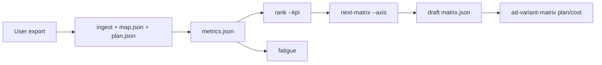

# Ad Performance Loop

Turn an exported results file into a ranked, explainable read of which
variants won, which are fatiguing, and what to test next. This leaf reads files
the user supplies; it never connects to an ad platform and never generates
media. Compose with `ad-variant-matrix`, which plans and names the variants
this skill joins on and turns the drafted next matrix into rows.

**Key rule: compare variants within one account, one audience and one time
range.** No hook rate, CTR or CPA is "good" or "bad" by an outside number here;
vendor benchmarks disagree and none is official.

## Inputs

| Input | Required | Notes |
| --- | --- | --- |
| Results CSV exported by the user | yes | Comma, semicolon or tab separated; UTF-8 with or without BOM |
| Column mapping (`map.json`) | yes | Maps fields to the export's own header names; see [column mapping](references/column-mapping.md) |
| Variant plan (`plan.json` from `variant_matrix.py plan`) | for joins and the next matrix | Supplies variant names and their axis values |
| The matrix that produced the variants | for `next-matrix` | Campaign, concept and `max_variants` carry over; legacy budgets do not |
| KPI | yes | `hook_rate`, `ctr`, `cvr` or `cpa`; ask when the user has not chosen |

Ask which KPI matters when the user has not said. Suggest `cpa` for a
conversion goal, `ctr` for traffic, and `hook_rate` for testing openings, but
let the user decide.

## Procedure

Script: `.agents/skills/ad-performance-loop/scripts/performance_loop.py`,
run with `uv run python`. Every command prints JSON with `ok`.

1. **Ingest.** `performance_loop.py ingest <export.csv> --map map.json
   --variants projects/<campaign>/variants/plan.json --out
   projects/<campaign>/performance/metrics.json`. The printed summary lists
   mapped columns missing from the export, `unmatched_ads`, `ambiguous_ads`
   (ad name to the variants it matched), `variants_without_data` and
   `skipped_rows`, with a `counts` object for each plus records and unreadable
   values (`issues`, detailed in the metrics file). **Report every one of
   these to the user**; never drop them silently.
2. **Rank.** `performance_loop.py rank metrics.json --kpi <kpi>
   [--min-impressions N] [--across-groups]`. Entities are variants (or raw ad
   names when unmatched). **Ranking is within comparable groups by default:**
   variants with the same `market` and `ratio` plan values (a missing value is
   `-`) rank against each other, because different markets and placements
   reach different audiences. Unmatched ads form their own `unmatched` group.
   Each ranked entity carries `group` and its `rank` inside that group, and
   `groups` lists each group's leader. `--across-groups` ranks everything
   together in one `all` group; use it only when the user asks and say that
   audiences differ. An entity is not ranked when an input column is missing, its
   denominator is zero (no impressions, clicks or conversions) or it is below
   the impression floor; the reason is printed. **The floor defaults to 1000
   impressions** so a handful of impressions cannot win; an export without an
   impressions column needs an explicit `--min-impressions 0`. Agree the
   floor with the user before ranking when volumes are small. A ranked entity
   below 1000 impressions (possible only with a lowered floor) is marked
   `low_volume: true`; say so beside the ranking.
3. **Check fatigue.** `performance_loop.py fatigue metrics.json
   [--window-days 7]`. Rows are bucketed into date windows from the earliest
   date; a variant is `fatigued` when, in its latest window versus the
   previous one, frequency rose while CTR or hook rate fell. Without a date,
   reach or frequency column the status is `insufficient_data`, never a guess.
4. **Draft the next round.** `performance_loop.py next-matrix metrics.json
   --matrix variants/matrix.json --kpi <kpi> --axis <axis>=<v1>,<v2>
   [--hero-value <current value>] --out variants/round-02/matrix.json`. The
   draft keeps the winner's values for every axis already tested, varies one
   new axis, bumps `version`, carries the source matrix's `naming` and
   `unit_cost_usd`, and is `status: draft` with an empty hero hash. It uses
   the same 1000-impression default floor and comparable groups as `rank`:
   when matched variants span more than one market or ratio group it refuses
   until `--group "market=<m>,ratio=<r>"` (as printed by `rank`) or
   `--across-groups` is passed. It reports `winner_fatigue` from the same rule
   as `fatigue` (`--window-days`, default 7) and prints `warnings` when the
   winner is low volume, is flagged fatigued, or was chosen across groups. It
   refuses a custom `naming` that lacks the new axis placeholder and refuses
   to overwrite an existing file. **Surface every warning before handing
   off**; a fatigued winner needs the user's decision to build on it.
5. **Hand off.** Bind the draft's hero to the approved winning take (shot,
   take, SHA-256, decision), then plan and cost it with `ad-variant-matrix`.

## Reading the results honestly

Read [interpretation](references/interpretation.md) before presenting a
ranking. In short:

- Present the KPI, its direction, the impression floor, and how many rows and
  days each variant has. Small differences on small volumes are not winners.
- Show `unmatched_ads`, `ambiguous_ads`, `variants_without_data` and
  `skipped_rows` beside the ranking.
- Present each comparable group's ranking separately; never call a variant
  the overall winner across markets or ratios from a default ranking.
- Hook rate counts 3-second views over impressions; it is only meaningful for
  video ads and only when the export's 3-second view column is mapped.
- Do not call a result statistically significant; this skill computes no
  significance test. Suggest letting a close race run longer instead.
- A fatigue flag is a prompt to refresh creatives, not proof of fatigue.

## Boundaries

- No platform API, login or scraping; the user exports the file.
- No invented data: missing values stay missing and are reported.
- No external benchmark is presented as official.
- Exports can contain account data. Keep them under the project folder, never
  in the repository, and do not paste raw rows into shared documents.
