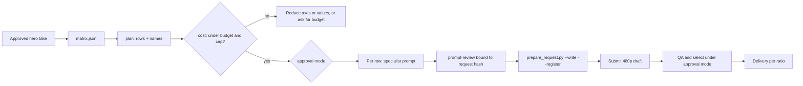

# Ad Variant Matrix

This skill is an **explicitly-marked orchestrator**. It plans and sequences
variant production around one approved hero ad and delegates every prompt,
edit and render to the specialist skills named below. It never calls a
provider itself and never bypasses prompt-review, the registry or the approval
mode.

**Key rule: change one axis per variant unless the user explicitly asks for a
full factorial.** One change per row is what makes a result attributable.

## When to use

| Request | Use |
| --- | --- |
| "Make variants of this approved ad", "test three hooks and two talents" | this skill |
| Several different hero concepts compared against each other | a concept test (see [testing guidance](references/testing-guidance.md)); build each hero first, then one matrix per concept |
| Write or revise the hero ad itself | `ugc-ad-modes` or `film-production` |
| Rank exported results and plan the next round | compose with `ad-performance-loop` |

## Inputs and preconditions

1. **An approved hero take.** Its shot ID, take, SHA-256 and the decision
   record that approved it under the project's `approval_mode`. A candidate in
   `review` is not a hero.
2. **The hero's current value for every axis** that will vary (for example
   `hook: hook-demo-first`, `talent: vp-a`, `ratio: 9:16`). Values are IDs:
   hook IDs from the `ugc-ad-modes` hook library, element IDs for talent,
   product, outfit and location, language codes, ratios.
3. **Approved references for every new value**: Virtual Portrait `asset://`
   views for talent, official or authorized packshots for products, garment
   and location sheets. A missing or unapproved reference blocks only the rows
   that need it.
4. **Unit cost per axis** in USD from current pricing for the route and
   resolution, or the user's stated figure. Never guess a price; ask.
5. **Budget and cap**: `budget_usd` and `max_variants`. Ask when either is
   missing; do not default to "no limit".

## Procedure



1. **Write the matrix** at `projects/<campaign>/variants/matrix.json`
   following `.agents/contracts/schemas/variant-matrix.schema.json`. Start with
   `status: draft`.
2. **Plan.** `uv run python .agents/scripts/variant_matrix.py plan <matrix>`
   expands rows in a deterministic order (hero first, then axes in the fixed
   order hook, talent, product, outfit, location, language, ratio) and checks
   unique names, the variant cap and empty matrices. A warning above five
   variants means the rows belong in more than one ad group.
3. **Cost.** `variant_matrix.py cost <matrix> --unit-cost hook=<usd> ...`
   sums one unit cost per routed step of each row, covering that step's draft
   and final. A swap, hook, dub or reframe step costs its axis unit; a
   talent-and-location row routed to one Motion Transfer costs one
   `motion-recast` unit (`--unit-cost motion-recast=<usd>`), not two swaps.
   It exits 1 over `budget_usd` or `max_variants`, or when a routed step has
   no unit cost. Show the per-row and total estimate before any spend. A
   refusal here is a stop under **`ad.variant_budget_gate`**.
4. **Approve the matrix.** In `approve_for_me` the agent may set `status:
   approved` once the plan and cost pass and the hero hash is bound. In
   `ask_for_approval` show the rows, names and total, and wait for the user's
   chat confirmation. The approval covers the plan only; each generated take is
   still selected separately.
5. **Prepare registration.** `variant_matrix.py register <matrix> --project
   projects/<campaign> --unit-cost ... --video-model <id> --video-operation
   <op> --capabilities <evidence.json>` (plus `--audio-model` and
   `--audio-operation` when language rows exist) refuses a draft matrix, an
   unbound hero, or unresolved model, operation or capability values, and
   prints per provider step the `prepare_request.py` hash command and
   register command. It is a dry plan: it writes nothing and submits nothing.
   - **Draft first.** The default `--stage draft` adds `--param
     resolution=480p` to both commands; hook steps also get
     `--param duration=4`.
   - **Required rules.** Every step carries `--required-rule` for
     `ad.claims_supported`, `ad.no_fabricated_testimonial`,
     `brand.copy_rules`, `library.pin_current`, `ad.variant_one_axis` and
     `ad.variant_budget_gate`; video steps add `video.text_free`. Hook steps
     add `shot.plan_bound`, `shot.variety` and `shot.axis_carry` unless
     `--static-by-design <format>` records a static-by-design exemption.
     Swap and Motion Transfer steps record the source-preserving-edit
     exemption and dub steps the no-video-shot exemption in
     `shot_rule_exemption`; the reviewer cites that exemption.
   - **Asset IDs** are `<name>_<take>_draft`, `<name>_<take>_final` or
     `<name>_<take>_audio` (multi-step rows insert the step axes after the
     name), so drafts, finals and retakes each get a distinct registry
     identity.
   - **Paths** live in the variant's Studio shot folder
     `scenes/variant-<kebab-name>/` (see [Studio mapping](#studio-mapping)).
6. **Produce each row** through the route below. For every provider step:
   write the shot manifest, write the prompt with the specialist skill, freeze
   it at the printed path, run the hash command, run `prompt-review` inline
   bound to that hash, resolve CRITICAL and MAJOR findings, run the register
   command, then submit. Steps within a row run in their `after` order;
   independent rows may run in parallel with explicit file ownership.
7. **QA and select** each 480p draft under the approval mode with a
   hash-bound decision, then run `register --stage final --final-resolution
   <delivery target>` for the selected rows and repeat review, registration,
   QA and selection for the final. Place each selected take in its variant
   shot in Studio and record the selection. Rows that fail QA keep their
   name; a retake is a new `--take t02`, not a new variant name.
8. **Deliver** each selected variant per placement with `ad-delivery-formats`
   and run `ad-creative-check` before paid upload.

## Routing per axis

Read [axis routing](references/axis-routing.md) before writing the first row
prompt. Summary:

| Axis | Route | Specialists | Provider step |
| --- | --- | --- | --- |
| `hook` | Regenerate the opening beat at the 4 s minimum duration, trim it to the hero's opening span and splice it onto the hero in Studio | `ugc-ad-modes` hook library, `seedance-prompt-25` | yes |
| `talent`, `product`, `outfit`, `location` | Object Swap on the muted hero master; keeps motion, framing, cuts and timing | `source-subject-map`, then `seedance-object-swap` | yes |
| `talent` + `location` in one row | One Motion Transfer instead of two swaps; costs one `motion-recast` unit | `seedance-motion-recast` | yes |
| `language` | Re-voice the locked script, then per-language captions | `audio-dubbing`, `seedance-prompt-25-dialogue`, `ad-captions` | yes (audio) |
| `ratio` | Reframe or native regeneration per placement | `ad-delivery-formats` | none for a reframe |

Two swap classes in one factorial row (for example product and outfit) run as
**sequential** swaps with inspection between them, never one combined edit.

## Studio mapping

Studio discovers only `scenes/scene-*/*/shot.md` and `scenes/*/shot.md`, so
every variant row that changes a generated axis is its own Studio shot in the
campaign project. A ratio-only row has no Studio shot there: its `delivery`
entry names the per-ratio project (`projects/<campaign>-<ratio>`, for example
`-4x5`) that `ad-delivery-formats` builds, because one Studio project renders
one canvas.

- Shot folder: `scenes/variant-<kebab-name>/`, where `<kebab-name>` is the
  variant name lowercased with `_` turned into `-` (folders and IDs are
  kebab-case; the variant name and asset file names keep their underscores).
- Manifest: `scenes/variant-<kebab-name>/shot.md` with the frontmatter the
  planner prints in each row's `studio.frontmatter` (`shot_id`, `title`,
  and `variant`). Add `takes`,
  `duration_s` and `resolution` as takes arrive, as for any shot.
- Prompts, reviews and takes sit in that folder, so `studio_project.py
  place` and `record-selection` work on the variant like any other shot. The
  hero keeps its own shot; the planner refuses names that map to the same
  folder.
- `variants/matrix.json` and the saved `plan.json`, `cost.json` and
  `register.json` stay the plan records.

## Matrix file

```json
{
  "schema_version": 1,
  "status": "draft",
  "campaign": "spring-launch",
  "concept": "morning-ritual",
  "hero": {
    "shot_id": "s01_sh010",
    "take": "t03",
    "sha256": "<64-hex of the approved hero take>",
    "decision_ref": "decisions/s01_sh010_t03.json",
    "values": {"hook": "hook-demo-first", "talent": "vp-a", "language": "en", "ratio": "9:16"}
  },
  "axes": {
    "hook": ["hook-problem-callout", "hook-product-interrupt"],
    "talent": ["vp-b"],
    "language": ["es"],
    "ratio": ["4:5", "1:1"]
  },
  "strategy": "one_axis_at_a_time",
  "max_variants": 8,
  "budget_usd": 40,
  "version": 1
}
```

- `hero.values` may also hold **fixed axes** that do not vary; they stay in
  every name so a later round can tell which winner it kept.
- `naming` is optional. The default joins campaign, concept, every hero-value
  axis in fixed order and `v{nn}`; ratios render as `9x16`. A custom pattern
  may use only `{campaign}`, `{concept}`, `{nn}` and axis placeholders, and
  must keep names unique.
- `unit_cost_usd` may record agreed unit costs per axis and `motion-recast`;
  `--unit-cost` overrides it.
- Platform ad names must contain the variant name unchanged so
  `ad-performance-loop` can join results.

## Gates

- **One axis per variant (`ad.variant_one_axis`).** Each variant changes one
  axis from the hero unless the user explicitly asked for a full factorial;
  record that request in the matrix `notes`.
- **Budget gate (`ad.variant_budget_gate`).** No variant production proceeds
  after `variant_matrix.py cost` refuses the matrix for budget or variant
  count.
- **No hero, no matrix.** A hero that is not approved, or whose file hash no
  longer matches `hero.sha256`, stops the matrix.
- **Budget and cap refuse, they do not trim.** When `cost` exits 1, propose
  which axis or values to drop, or ask for a higher budget. Never silently
  drop rows.
- **Every row is a normal generation.** Prompt-review, frozen prompts, request
  hashes, registry registration before submission, 480p drafts first and the
  approval mode apply to each provider step exactly as for any other shot.
- **Facts and CTA never vary by accident.** A hook row changes the opening
  beat only; a language row translates the locked script; no row invents a
  claim, offer or testimonial. Check rows against
  `.agents/contracts/ad-compliance.md`.
- **Real people stay authorized.** Talent rows use Virtual Portrait or
  authorized `asset://` references per `seedance-virtual-portrait`.
- **Text stays in post.** Supers, captions and CTAs are added per ratio in
  Studio, never prompted into generated footage.

## Testing guidance

Read [testing guidance](references/testing-guidance.md) when the user asks how
many variants to make, how to split ad groups, or whether to run a concept
test or a variation test. It records the dated official guidance and the
practitioner conventions this skill follows.

## Output

- `variants/matrix.json` (approved) and the plan, cost and register outputs
  saved beside it as `plan.json`, `cost.json` and `register.json`.
- Per variant: `scenes/variant-<kebab-name>/shot.md`, and in the same folder
  `prompt_<asset>.md`, its review, request, registry entry, takes and QA
  notes.
- A short summary for the user: rows, names, estimated total versus budget,
  rows blocked and why, and the next action. Update `handoff.md` before any
  long wait.
