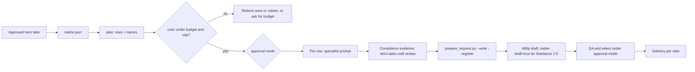

# Ad Variant Matrix

This skill is an **explicitly-marked orchestrator**. It plans and sequences
variant production around one approved hero ad and delegates every prompt,
edit and render to the specialist skills named below. It never calls a
provider itself and never bypasses applicable review requirements, the registry
or the approval mode.

Read independent `review_mode` and `approval_mode` from `project.md`. Missing
fields use default/approve_for_me for new actions; invalid values fail.
Default skips blanket prompt-craft checklists, but video is draft-first in both modes. Four focused
compliance records still require an honest request-bound report for Marketing
variants: `ad.claims_supported`, `ad.no_fabricated_testimonial`,
`brand.copy_rules` and `library.pin_current`. Do not fabricate passes when
facts, brand rules or pin evidence are missing. Strict retains the full
existing review. Budget and one-axis checks run in code in both modes.

**Key rule: change one axis per variant unless the user explicitly asks for a
full factorial.** One change per row is what makes a result attributable.

## When to use

| Request | Use |
| --- | --- |
| "Make variants of this approved ad", "test three hooks and two talents" | this skill |
| Several different hero concepts compared against each other | a concept test (see [testing guidance](references/testing-guidance.md)); build each hero first, then one matrix per concept |
| Write or revise the hero ad itself | `seedance-ugc-ads` or `film-production` |
| Rank exported results and plan the next round | compose with `ad-performance-loop` |

## Inputs and preconditions

1. **An approved hero take.** Its shot ID, take, SHA-256, the take file
   (`hero.take_file`) and the decision record that approved it under the
   project's `approval_mode` (`hero.decision_ref`), both as paths inside the
   campaign project. A candidate in `review` is not a hero.
2. **The hero's current value for every axis** that will vary (for example
   `hook: hook-demo-first`, `talent: vp-a`, `ratio: 9:16`). Values are IDs:
   hook IDs from the `seedance-ugc-ads` hook library, element IDs for talent,
   product, outfit and location, language codes, market IDs (kebab-case, the
   folder name of the market card), ratios.
3. **Approved references for every new value**: Virtual Portrait `asset://`
   views for talent, official or authorized packshots for products, garment
   and location sheets. A missing or unapproved reference blocks only the rows
   that need it.
4. **Unit cost per axis** in USD from current pricing for the route and
   resolution, or the user's stated figure. Never guess a price; ask. Only
   `ratio` has a default: 0, because a Studio reframe is not a provider
   operation.
5. **Budget and cap**: `budget_usd` and `max_variants`. Ask when either is
   missing; do not default to "no limit".

## Procedure



1. **Write the matrix** at `projects/<campaign>/variants/matrix.json`
   following `.agents/contracts/schemas/variant-matrix.schema.json`. Start with
   `status: draft`.
2. **Plan.** `uv run python .agents/scripts/variant_matrix.py plan <matrix>`
   expands rows in a deterministic order (hero first, then axes in the fixed
   order hook, talent, product, outfit, location, language, market, ratio) and
   checks unique names, unique Studio shot folders, unique localized and
   delivery projects (`matrix.unique_projects`), the variant cap, empty
   matrices and rows that change market and language together. A
   `full_factorial` matrix without `notes` recording the user's request is
   refused (`matrix.factorial_request`). A warning above five
   variants means the rows belong in more than one ad group.
3. **Cost.** `variant_matrix.py cost <matrix> --unit-cost hook=<usd> ...`
   charges one unit per **unique operation** (see
   [Shared operations](#shared-operations)), covering its draft and final:
   a swap, hook or dub its axis unit; a talent-and-location Motion Transfer
   one `motion-recast` unit, not two swaps; a market adaptation the explicit
   `market` unit once per localized project, labelled an estimate in
   `market_estimate_note` because `ad-localize` chooses the real per-element
   levels; a reframe the `ratio` unit once per delivery project, **0 by
   default** (`ratio_cost_note`), set only to budget native regeneration.
   Each row's `estimated_cost_usd` counts the operations it owns;
   `operations_estimate` lists each unique operation with its owner and
   `used_by` rows; the total and the budget gate use these deduplicated
   costs. It exits 1 over `budget_usd` or `max_variants`, or when a routed
   step has no unit cost. Show the per-row and total estimate before any
   spend. A refusal here is a stop under **`ad.variant_budget_gate`**.
4. **Approve the matrix.** In `approve_for_me` the agent may set `status:
   approved` once the plan and cost pass and the hero hash is bound. In
   `ask_for_approval` show the rows, names and total, and wait for the user's
   chat confirmation. The approval covers the plan only; each generated take is
   still selected separately.
5. **Prepare registration.** `variant_matrix.py register <matrix> --project
   projects/<campaign> --unit-cost ... --video-model <id> --video-operation
   <op> --capabilities <evidence.json>` (plus `--audio-model` and
   `--audio-operation` when language rows exist) refuses a draft matrix, an
   unbound hero, or unresolved model, operation or capability values, and
   prints per owned provider step the `prepare_request.py` hash command and
   register command. It is a dry plan: it writes nothing and submits nothing.
   - **Hero check.** `hero.decision_ref` and `hero.take_file` must each be a
     regular file inside `--project` (no absolute path, `..` or symlink
     escape; `matrix.hero_decision`, `matrix.hero_take`), and the take file
     must still hash to `hero.sha256` (`matrix.hero_hash_mismatch`).
   - **Generation target.** Both modes default to `--stage draft`, adding
     `--param resolution=480p` and, for resolved Seedance 2.5 models,
     `--param draft=true`. A delivery target alone does not bypass drafts.
     Resolve schema or transport mismatches without dropping the native flag.
     Other models without native Draft use plain 480p tests. Hook steps also
     get `--param duration=4`; audio steps get neither video parameter.
     Explicit production/final stages remain available for other models.
     For 2.5, the planner refuses those stages: prepare promotions individually
     from selected `draft_task_id` values and supported output settings, since
     the matrix has no per-row native draft selection.
   - **Required rules.** Strict steps carry `--required-rule` for
     `ad.claims_supported`, `ad.no_fabricated_testimonial`,
     `brand.copy_rules`, `library.pin_current`, `ad.variant_one_axis` and
     `ad.variant_budget_gate`; video steps add `video.text_free`. Hook steps
     add `shot.plan_bound`, `shot.variety` and `shot.axis_carry` unless
     `--static-by-design <format>` records a static-by-design exemption.
     Swap and Motion Transfer steps record the source-preserving-edit
     exemption and dub steps the no-video-shot exemption in
     `shot_rule_exemption`; the reviewer cites that exemption. Default retains
     only the four compliance rules above. Do not load universal or shot-craft
     checklists for those focused records.
   - **Asset IDs** are `<name>_<take>_production`, `<name>_<take>_draft`,
     `<name>_<take>_final` or `<name>_<take>_audio`, so stages and retakes get a distinct
     registry identity. A row registers at most its own last step; `after`
     names the variant whose selected take that step starts from.
   - **Paths** live in the variant's Studio shot folder
     `scenes/variant-<kebab-name>/` (see [Studio mapping](#studio-mapping)).
   - **Market rows** get no command. The output lists each localized project
     once under `localize` (the row that owns it) with the market card, the
     market inventory, the localized project and a reminder that
     `ad-localize` plans, reviews and registers its own operations.
6. **Produce each row** through the route below. For every provider step:
   write the shot manifest, write the prompt with the specialist skill, freeze
   it at the printed path, run the hash command, record the focused compliance
   evidence (full `prompt-review` in strict) bound to that hash, resolve
   failing or incomplete evidence, run the register
   command, then submit. Steps within a row run in their `after` order;
   independent rows may run in parallel with explicit file ownership.
7. **QA and select** the actual output under the approval mode with a
   hash-bound decision. Default needs short actual candidate/final sanity,
   not a full craft checklist. For other models without native Draft, run
   `register --stage final --final-resolution
   <delivery target>` for the selected rows and repeat review, registration,
   QA and selection for the final. For 2.5, register a native promotion from
   the selected draft instead; changed inputs start another native Draft.
   Place each selected take in its variant
   shot in Studio and record the selection. Rows that fail QA keep their
   name; a retake is a new `--take t02`, not a new variant name.
8. **Deliver** each selected variant per placement with `ad-delivery-formats`
   and run `ad-creative-check` before paid upload.

## Routing per axis

Read [axis routing](references/axis-routing.md) before writing the first row
prompt. Summary:

| Axis | Route | Specialists | Provider step |
| --- | --- | --- | --- |
| `hook` | Regenerate the opening beat at the 4 s minimum duration, trim it to the hero's opening span and splice it onto the hero in Studio | `seedance-ugc-ads` hook library, `seedance-prompt-25` | yes |
| `talent`, `product`, `outfit`, `location` | Object Swap on the muted hero master; keeps motion, framing, cuts and timing | `source-subject-map`, then `seedance-object-swap` | yes |
| `talent` + `location` in one row | One Motion Transfer instead of two swaps; costs one `motion-recast` unit | `seedance-motion-recast` | yes |
| `language` | Re-voice the locked script, then per-language captions | `audio-dubbing`, `seedance-prompt-25-dialogue`, `ad-captions` | yes (audio) |
| `market` | Adapt the variant for one market at the per-element levels recorded in that market's `inventory.md` (captions, voice, talent, cultural or full transcreation; the card holds `level_default`) | `ad-localize` | none from the planner; `ad-localize` registers its own |
| `ratio` | Reframe or native regeneration per placement | `ad-delivery-formats` | none for a reframe |

Two swap classes in one factorial row (for example product and outfit) run as
**sequential** swaps with inspection between them, never one combined edit.

## Shared operations

In a full factorial the planner keys every step on its lineage (its route and
changed values plus every earlier step in the row). The first row with a
lineage **owns** that operation; later rows reuse it (`steps[].owner`,
`base_variant`) and never register or pay for it again, so one talent swap
serves its market and ratio rows. Read
[shared operations](references/axis-routing.md#shared-operations) before
producing a factorial.

## Studio mapping

Studio discovers only `scenes/scene-*/*/shot.md` and `scenes/*/shot.md`, so
every variant row that owns a generated step (hook, swap, recast or dub) is
its own Studio shot in the campaign project. A row that only reuses another
row's generated work has no Studio shot; its `base_variant` names the shot
whose selected take it starts from. Market and ratio rows build into their own
projects because one Studio project renders one canvas: the `localize` entry
names the market card `projects/<campaign>/markets/<market-id>/market.json`
and the localized project `projects/<campaign>[-<variant-key>]-<market-id>`
that `ad-localize` owns, and the `delivery` entry names the per-ratio project
`projects/<campaign>[-<variant-key>][-<market-id>]-<ratio>` (ratios render as
`4x5`) that `ad-delivery-formats` builds. `<variant-key>` joins the row's
changed generated values in axis order, so two variants never share a
project; `plan` refuses any remaining clash with `matrix.unique_projects`. The
full table is in [axis routing](references/axis-routing.md#project-paths).

- Shot folder: `scenes/variant-<kebab-name>/`, where `<kebab-name>` is the
  variant name lowercased with `_` turned into `-` (folders and IDs are
  kebab-case; the variant name and asset file names keep their underscores).
- Manifest: `scenes/variant-<kebab-name>/shot.md` with the frontmatter the
  planner prints in each row's `studio.frontmatter` (`shot_id`, `title`,
  and `variant`). Add `takes`,
  `duration_s` and `resolution` as takes arrive, as for any shot.
- Prompts, reviews and takes sit in that folder, so `studio_project.py
  place` and `record-selection` work on the variant like any other shot. The
  hero keeps its own shot; the planner refuses names that map to the same
  folder.
- `variants/matrix.json` and the saved `plan.json`, `cost.json` and
  `register.json` stay the plan records.

## Matrix file

```json
{
  "schema_version": 1,
  "status": "draft",
  "campaign": "spring-launch",
  "concept": "morning-ritual",
  "hero": {
    "shot_id": "s01_sh010",
    "take": "t03",
    "sha256": "<64-hex of the approved hero take>",
    "decision_ref": "decisions/s01_sh010_t03.json",
    "take_file": "scenes/s01_sh010/s01_sh010_t03_final.mp4",
    "values": {"hook": "hook-demo-first", "talent": "vp-a", "language": "en", "ratio": "9:16"}
  },
  "axes": {
    "hook": ["hook-problem-callout", "hook-product-interrupt"],
    "talent": ["vp-b"],
    "language": ["es"],
    "ratio": ["4:5", "1:1"]
  },
  "strategy": "one_axis_at_a_time",
  "max_variants": 8,
  "budget_usd": 40,
  "version": 1
}
```

- `hero.values` may also hold **fixed axes** that do not vary; they stay in
  every name so a later round can tell which winner it kept.
- `naming` is optional. The default joins campaign, concept, every hero-value
  axis in fixed order and `v{nn}`; ratios render as `9x16`. A custom pattern
  may use only `{campaign}`, `{concept}`, `{nn}` and axis placeholders, and
  must keep names unique.
- `unit_cost_usd` may record agreed unit costs per axis (including `market`)
  and `motion-recast`; `--unit-cost` overrides it.
- Platform ad names must contain the variant name unchanged so
  `ad-performance-loop` can join results.

## Gates

- **One axis per variant (`ad.variant_one_axis`).** Each variant changes one
  axis from the hero unless the user explicitly asked for a full factorial;
  record that request in the matrix `notes`. `plan` refuses a
  `full_factorial` matrix with empty `notes` (`matrix.factorial_request`).
- **Market owns its language.** A row that changes `market` and `language`
  together is refused (`matrix.market_language`): the market card sets the
  language inside `ad-localize`. Test language alone, or market alone, one
  axis at a time.
- **Market rows hand off, they do not generate.** The planner neither
  chooses the localization levels nor registers their operations;
  `ad-localize` records per-element levels in the market's `inventory.md` and
  registers its own operations, so a market row's cost stays an estimate until
  that plan exists.
- **One project per variant (`matrix.unique_projects`).** No two different
  variants share a localized or delivery project; rename a value that
  collides.
- **Budget gate (`ad.variant_budget_gate`).** No variant production proceeds
  after `variant_matrix.py cost` refuses the matrix for budget or variant
  count.
- **No hero, no matrix.** A hero that is not approved, has no decision record
  inside the project, or whose take file no longer hashes to `hero.sha256`
  stops the matrix; `register` checks all three.
- **Budget and cap refuse, they do not trim.** When `cost` exits 1, propose
  which axis or values to drop, or ask for a higher budget. Never silently
  drop rows.
- **Every row is a normal generation.** Mode-appropriate review, frozen
  prompts, request hashes, registry registration before submission and the
  approval mode apply to each provider step. Both modes default to 480p drafts,
  with explicit boolean `draft: true` for every new Seedance 2.5 generation.
- **Facts and CTA never vary by accident.** A hook row changes the opening
  beat only; a language row translates the locked script; no row invents a
  claim, offer or testimonial. Check rows against
  `.agents/contracts/ad-compliance.md`.
- **Real people stay authorized.** Talent rows use Virtual Portrait or
  authorized `asset://` references per `seedance-virtual-portrait`.
- **Text stays in post.** Supers, captions and CTAs are added per ratio in
  Studio, never prompted into generated footage.

## Testing guidance

Read [testing guidance](references/testing-guidance.md) when the user asks how
many variants to make, how to split ad groups, or whether to run a concept
test or a variation test. It records the dated official guidance and the
practitioner conventions this skill follows.

## Output

- `variants/matrix.json` (approved) and the plan, cost and register outputs
  saved beside it as `plan.json`, `cost.json` and `register.json`.
- Per variant: `scenes/variant-<kebab-name>/shot.md`, and in the same folder
  `prompt_<asset>.md`, its review, request, registry entry, takes and QA
  notes.
- A short summary for the user: rows, names, estimated total versus budget,
  rows blocked and why, and the next action. Update `handoff.md` before any
  long wait.
