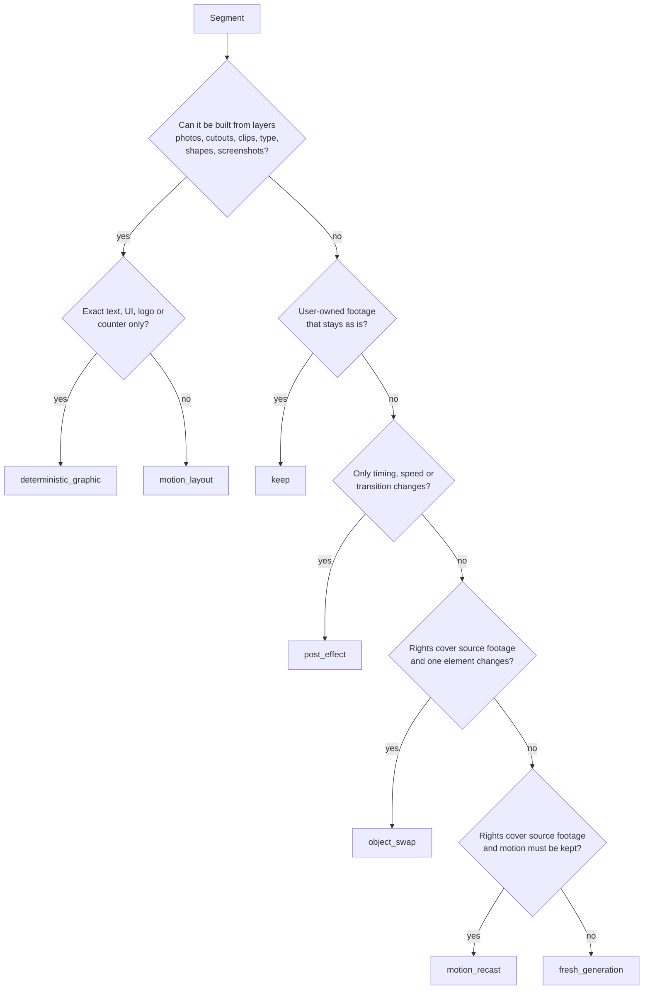

# Segment Routing

Every EDL segment gets exactly one route. Mixed edits are normal. The default
depends on the format: people-led edits (aura farming, fashion, character)
default to `fresh_generation` shots cut into short appearances; product, logo
and motion-graphics edits default to `motion_layout`. Type and effects are
always deterministic on top of either. See the [quality bar](quality-bar.md).

## Decision order

## Routes

| Route | Method | Notes |
| --- | --- | --- |
| `motion_layout` | HyperFrames composition: asset layers animated with keyframes, masks, easing, parallax, type and transitions on the EDL timeline | Default for product reveals, lookbook cards, launch sequences and motion-graphic intros. Supplied photos are placed as unaltered pixels. No credits |
| `deterministic_graphic` | One HTML entrypoint rendered by `html-graphic-render`, animated in HyperFrames when it moves | Exact copy, fonts, UI, logos, price and CTA cards, counters, lower-thirds |
| `keep` | Place the user's own footage unchanged | Record the source hash |
| `post_effect` | FFmpeg or HyperFrames | Speed ramps, flashes, freezes, zooms, transitions |
| `fresh_generation` | Seedream first frame with the locked identity references, then Seedance 2.5 image-to-video (no `ratio` with a first frame), prompt per `seedance-prompt-25` | Default for people-led edits: 5-8 distinct setups, each generated once and cut into many short appearances. Elsewhere, needs a recorded reason |
| `motion_recast` | `seedance-motion-recast` | Source clip, rights recorded, cast and world rebuilt around the same performance |
| `object_swap` | `seedance-object-swap` | One named element changes, rest preserved; footage owned or permitted |

## Reasons that justify generation

- The reference shows a person doing something no supplied photo can supply
  (walking, turning, a new pose), and a still animated as a layer would not
  read as the same beat.
- The reference shows a physical interaction (pour, fold, wear) with the
  product.
- The environment behind the subject must change and no plate is supplied.

For product and graphics formats, a static hero pose, a parallax reveal, a
slide-in, a scale punch or a mask wipe is **not** a reason: build it as
layers. For people-led formats, a repeated static cutout is not an acceptable
substitute for a moving shot.

## Layer preparation

- Cutouts need clean alpha. Produce them with a masking step (for example a
  `seedream-edit` background removal on the supplied photo) and inspect edges
  at 100 %; reject halos, lost fingers, cropped soles or label damage.
- Product and logo pixels stay as supplied. Never redraw them.
- Keep original and cutout hashes; a cutout is a derived asset with its own
  review.
- Plan safe margins for the reference's aspect ratio and the motion's travel.

## Generation windows

1. Resolve the live duration range and reference limits first.
2. Group consecutive `fresh_generation` segments into one window when they
   share subject, location and light and their total fits the range. Otherwise
   generate each natural-duration shot separately.
3. A window with hard cuts is generated as one clip, then cut at the EDL times
   in the assembly. Expect shifts of roughly 0.5–1.2 s on dense timelines;
   retime by trimming or clone-padding rather than regenerating.
4. A window never crosses a layered or kept segment.
5. Record per window: member segment IDs, requested duration, resolution
   (480p draft first), estimated cost and assigned assets in binding order.

## Reference footage as input

Binding the reference itself as a video input is allowed only for
`motion_recast` and `object_swap` with recorded rights, a muted source master
and the [video-to-video inputs contract](../../../contracts/video-to-video-inputs.md).
For layered and generated routes, describe the reference's structure and motion
in text and measurements; do not bind its frames.
