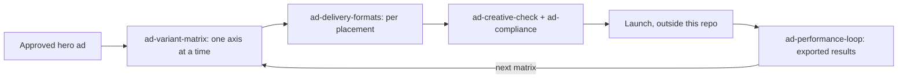
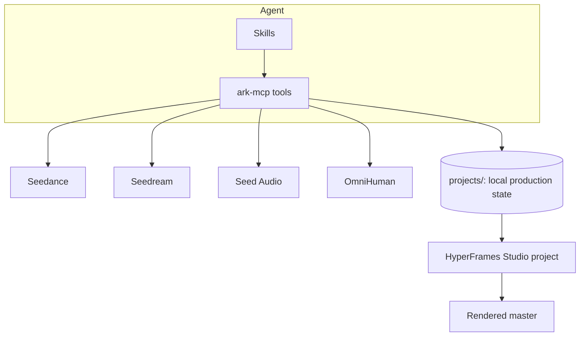

# seed-marketing-studio

> Skills, contracts and tooling for producing marketing content (UGC ads, product videos, cinematic TVCs, launch films, motion graphics, posters, spokesperson videos and audio spots) with BytePlus **Seedance** (video), **Seedream** (images), **Seed Audio** (audio) and **OmniHuman** (lip-sync avatars), finished and rendered in a HyperFrames Studio project.

> Pair this workspace with the [`byteplus-sa/ark-mcp`](https://github.com/byteplus-sa/ark-mcp) MCP server and the [ModelArk documentation](https://docs.byteplus.com/en/docs/ModelArk/1399008).

The studio is a set of **agent skills** that an MCP-capable coding agent (Claude Code, opencode or similar) loads on demand. Prompt skills write and review model-ready prompts; orchestrators sequence brief, canon, shots, review, assembly and delivery; tooling skills handle generation through MCP, deterministic graphics, FFmpeg post and HyperFrames rendering. Skills never call the Ark REST API directly.

**No market is built in.** The target market, language, brand voice and cultural setting always come from the brief.

---

## What it makes

| Deliverable | Start with |
| --- | --- |
| UGC, demo, review, try-on and showcase ads | `ugc-ad-modes`, `ugc-motion-presets` |
| Cinematic TVCs and brand films | `brief-intake`, `film-production`, `seedance-shot-design` |
| Fast-cut, multi-angle product ads, cinematic, CGI or hybrid | `seedance-kinetic-ads` |
| Launch videos, motion graphics, product hypermotion | `seedance-motion-design`, `hyperframes` |
| CGI product worlds, material transitions and surreal commercials | `seedance-cgi-advertising` |
| Viral effects and trend edits | `seedance-effects-studio`, `seedance-frame-break`, `reference-edit-rebuild` |
| Recreating a reference ad's grammar with your brand | `template-factory` |
| Product, outfit, talent or location swaps in existing footage | `seedance-object-swap`, `seedance-vfx-pipeline` |
| Talent, cast or style variants of an approved take | `seedance-motion-recast`, `seedance-restyle` |
| Spokesperson and avatar videos | `seedance-ai-avatar`, `seedance-avatar-news`, `omnihuman-prompt-20` |
| Key visuals, posters, product sheets | `seedream-prompt`, `seedream-prop-asset`, `html-graphic-render` |
| Radio and audio spots, jingles, soundscapes | `seed-audio-commercial`, `seed-audio-prompt` |
| Localized versions of a finished ad, from captions only to full transcreation | `ad-localize`, `ad-captions`, `audio-dubbing`, `seedance-prompt-25-dialogue` |
| Music-led brand films | `seedance-music-video` |
| Brand kit and product card from a URL | `brand-kit`, `product-intake` |
| Hook, angle, talent, language, market and ratio test variants | `ad-variant-matrix`, `ugc-ad-modes` (hooks, settings, script formulas) |
| Static ad grids and marketplace product shots | `static-ad-batch`, `seedream-product-shot` |
| Per-placement cuts, captions and pre-spend QA | `ad-delivery-formats`, `ad-captions`, `ad-creative-check` |
| Learning from results | `ad-performance-loop` |

---

## Model catalog

Credentials are resolved from the environment at runtime: `BYTEPLUS_MODELARK_API_KEY` for Seedream and Seedance, and `BYTEPLUS_SEED_AUDIO_API_KEY` for Seed Audio.

| Family | Model(s) | Modality | Key capabilities |
|---|---|---|---|
| Seedance | **Seedance 2.5** (default), up to 30 s per pass, 1080p, multimodal references. Seedance 2.0 for 4K, Fast or Mini. | Video | Text-to-video, first/last frame, multimodal references, editing, extension, native audio |
| Seedream | Seedream 5.0 Pro and configured Lite bindings | Image | Text-to-image, reference editing, multi-reference fusion, sequential output |
| OmniHuman | OmniHuman 2.0 (BytePlus Vision AI) | Video | Audio-driven lip-sync from one image and a 4 to 300 s track |
| Seed Audio | Seed Audio 1.0 | Audio | Voice, music, SFX and ambience in one pass; voice references; cross-lingual generation |

Resolve current model IDs and parameters from the MCP server or Ark CLI before generating; the skills record the defaults they were verified against.

---

## How a marketing project flows

```mermaid
flowchart LR
  K[Brand kit + product card] --> A[Brief and audience reaction]
  A --> B[Treatment and directing axes]
  B --> C[Canon: product, talent, location, exact graphics]
  C --> D[Shot plan]
  D --> E[Prompt and mode-appropriate preflight]
  E --> G[Generate at delivery target]
  G --> H[Studio assembly: supers, CTA, end card, mix]
  H --> I[Render and delivery QA]
```





- **Brand and product facts first.** `brand-kit` keeps logos, palette, fonts, voice and copy rules in a shared library; `product-intake` turns a product page into sourced facts. Only `supported` facts reach a script, super or static ad.
- **Brief first.** `brief-intake` records the intended audience reaction, the central visual idea, the product facts and the CTA, plus any cited reference ads.
- **Canon before shots.** Real logos and packshots are acquired from the brand, never regenerated. Exact copy, prices, CTAs and end cards are rendered with `html-graphic-render`; Seedream is for invented photography and illustration.
- **Text stays out of generated video.** Captions, taglines, CTAs and end cards are added in post (HyperFrames or FFmpeg).
- **Review depth is explicit.** Default uses one image, minimal preflight and final sanity, with no automatic draft-first pass. Strict retains detailed checks, three-image sampling and Seedance 480p draft-first.
- **Cinematic means planned coverage.** Narrative and ad shots carry a recorded shot plan (size, angle, move, lens intent, named light source) so spots do not read as a single static take.
- **Compliance is recorded, not assumed.** Claims, testimonials and AI disclosure for paid ads follow the [ad compliance contract](.agents/contracts/ad-compliance.md); placement specs live in the dated [ad platforms contract](.agents/contracts/ad-platforms.md).
- **Studio is the final authority.** HyperFrames Studio holds the locked assets and renders the delivery file.



---

## Getting started

### Prerequisites

- An agent runtime with MCP and skill support (Claude Code, opencode or similar).
- A BytePlus ModelArk account with API access, and the [`ark-mcp`](https://github.com/byteplus-sa/ark-mcp) server configured.
- Python 3.11+ and [uv](https://docs.astral.sh/uv/); FFmpeg for post.

```bash
BYTEPLUS_MODELARK_API_KEY=your_modelark_key
BYTEPLUS_SEED_AUDIO_API_KEY=your_seed_audio_key
```

Put these in a gitignored `.env`; never commit them.

### Quick start

1. Clone the repo, run `uv sync --locked`, and open it in your agent.
2. Build or pin a brand kit (`brand-kit`), add the product card (`product-intake`), then create `projects/<campaign>/project.md` with the brief (or ask the agent to run `brief-intake`).
3. Run `uv run python .agents/scripts/studio_project.py init <campaign>` and `stage <campaign> start brief-development`.
4. Build canon: acquire brand assets, render exact graphics with `html-graphic-render`, and lock Seedream sheets with `studio_project.py lock-element`.
5. Plan shots with `seedance-shot-design`, write prompts with the `seedance-*` skills, run mode-appropriate preflight, register the request, and submit through `ark-mcp`.
6. Place selected takes, supers and audio in Studio, then `studio_project.py render` and `stage <campaign> complete delivery`.

### Review and approval modes

New `project.md` frontmatter uses two independent settings:

```yaml
---
review_mode: default
approval_mode: approve_for_me
---
```

`default` means minimal preflight and actual final sanity, one generated image
per requested asset, and direct generation at the requested supported target.
No full prompt-review checklist/report or extra draft pass is mandatory.
Set `review_mode: strict` for the existing detailed checks, three-image
sampling and draft-first workflow. Explicit counts or draft requests win;
three-panel sheet and storyboard layouts are unchanged.

Studio runs the expensive HyperFrames check at delivery in both modes. Strict
also runs it at shot-generation and assembly-review; default skips those
intermediate checks with `check_ran: false` and `check_ok: false`. Status, placed
takes, provenance, locks and render freshness remain enforced.

`approve_for_me` lets the agent select and lock passing in-scope creative work;
`ask_for_approval` waits for your explicit choice. Neither review mode changes
that authority. Existing writers still need short truthful, hash-bound
candidate/final sanity evidence, never a fake checklist pass or user quote.
Missing mode fields use the defaults for new actions only; invalid values fail.

For ordinary default requests, omit `--review` from both commands:

```bash
uv run python .agents/scripts/prepare_request.py --project projects/<p> --asset <asset> --prompt <prompt.md> --model <model> --operation <operation> --expected-output <output> --write --register --capabilities <capabilities.json>
uv run python .agents/scripts/validate_request.py --project projects/<p> --request <request.json> --capabilities <capabilities.json>
```

Strict mode or any explicit `--required-rule <id>` requires `--review <file>`.
Any supplied failing, stale, malformed or incomplete review blocks in either
mode. Explicit approval/review mode selects version 2; legacy version selection
and hashes are preserved. The version-2 project digest invalidates pending
requests and reviews when the brief or mode changes; a version-1 request cannot
register or begin submission after either mode becomes explicit.

**Marketing residual:** default variant-matrix operations still require four
focused compliance records in a real request-bound report:
`ad.claims_supported`, `ad.no_fabricated_testimonial`, `brand.copy_rules` and
`library.pin_current`. Missing evidence stays blocked, not filled with fake
passes. Default variant registration uses `--stage production` and
`--final-resolution <target>` for video; strict defaults to `--stage draft`.
Rights, capabilities, reference locks, budget, registry and duplicate safety
remain. Paid-ad disclosure decisions need your actual words, platform-required
disclosures remain required, and L3-L5 localization still needs explicit native
human sign-off before final generation and delivery.

---

## Layout

| Path | Contents |
| --- | --- |
| `AGENTS.md` | Workspace contract for agents and contributors (`CLAUDE.md` links to it) |
| `.agents/skills/` | Every skill, one folder each; `.claude/skills/` holds relative symlinks |
| `.agents/contracts/` | Production, routing, element, naming, alignment, video-to-video, ad compliance, ad platform and shared-library contracts, rule IDs and schemas |
| `.agents/scripts/` | Request preparation, task registry, Studio bridge (`studio_project.py`), variant matrices (`variant_matrix.py`), the static preset gallery (`template_gallery.py`), catalog sync and validation |
| `.agents/catalog/` | Skill catalog and bundle integrity hashes |
| `tests/` | Registry, Studio, approval, validation, prompt-contract and campaign-layer script tests |
| `projects/<campaign>/` | Local only, never committed: brief, elements, scenes, variants, performance exports, task registry and Studio project |
| `library/` | Local only, never committed: shared brand kits (`library/brands/`) and approved talent (`library/talent/`) that campaigns pin by SHA-256 |

---

## Skills

The workspace ships **80 skills**. Leaf skills are independent; declared orchestrators compose them. Edit skills only under `.agents/skills/`.

### Orchestration and review

| Skill | Summary |
|---|---|
| **brief-intake** | Shape intent-led briefs; hand off footage for native-first, capability-checked analysis while preserving confirmed decisions. |
| **film-production** | Orchestrates multi-scene, multi-modality production one stage at a time while keeping one HyperFrames Studio project synchronized for review and handoff. |
| **template-factory** | Native-first ad reference analysis and quick structure clones mapped to sourced product facts, preserving campaign rights and review gates. |
| **prompt-review** | Review prompts for strict mode, explicit review requests or required rules; routine default production skips full checklists. Sub-agent review requires an explicit request. |
| **ad-variant-matrix** | Plan approved-ad variants with routing, cost and budget gates; default keeps four focused compliance records, strict adds craft review, and all operations register. |
| **ad-localize** | Adapt an approved ad to another market at the depth chosen per element: captions/text, voice, talent, cultural adaptation or full transcreation, with native review gates. |

### Campaign layer

| Skill | Summary |
|---|---|
| **brand-kit** | Build, validate and pin a sourced brand kit (logos, palette, fonts, voice, copy rules) in the shared library; unknown values stay null and listed, never invented. |
| **product-intake** | Turn a product URL or images into a sourced product card: facts with verbatim quotes and statuses plus hashed acquired images; only supported claims reach copy. |
| **ad-delivery-formats** | Turn one approved ad master into per-placement cuts: regenerate or reframe per ratio, lay out text inside dated safe zones, and check with overlay contact sheets. |
| **ad-captions** | Write per-language SRT/WebVTT ad captions from the locked script and measured timing, with an optional HyperFrames burn-in layer inside the placement safe zone. |
| **ad-creative-check** | Honest pre-spend pass/fail/needs-human checklist for a finished ad cut: reveal, logo, opening, safe zone, claims, speech, loudness and disclosure; no performance prediction. |
| **ad-performance-loop** | Rank a user-exported ad results CSV by variant (hook rate, CTR, CVR, CPA) within the account, flag fatigue, and draft the next variant matrix. |

### Ads, UGC and trend formats

| Skill | Summary |
|---|---|
| **ugc-ad-modes** | Write hooks, scripts and Seedance prompts for nine ad modes using supplied product facts, audience objections, supported claims and accurate CTAs. |
| **ugc-motion-presets** | Turn a named UGC motion preset (Atomic, Outfit Switch, Eating Zoom, Yacht, ...) into a canonical Seedance 2.5 prompt block with reference bindings, duration, and constraint flags. |
| **seedance-motion-design** | Write Seedance 2.5 motion-design prompts while routing exact typography and UI to deterministic post graphics and synthesized visual layers to Seedream. |
| **seedance-cgi-advertising** | Design product-led CGI worlds, camera moves, transition endpoints and sound cues, with exact-packaging boundaries and scoped repair guidance. |
| **seedance-kinetic-ads** | Design generalized kinetic ads with cinematic realism, CGI or hybrid treatments, varied coverage, product continuity, and explicit edit/sound handoffs. |
| **seedance-effects-studio** | Select a named effect recipe for the current source, preserve observed identity and wardrobe, and validate supported generation in the owning project's workflow. |
| **seedance-frame-break** | Write and QA Seedance 2.5 frame-break pop-out prompts where the subject is drawn over two fixed black bars, with a locked camera, staged break-outs, a product-hero variant, failure repairs and an all-frames pixel check of bar motion and overlap. |
| **reference-edit-rebuild** | Plans a reference edit rebuilt with your own characters, products or clothing: measured edit list, beat grid and motion inventory, varied generated shots for people-led formats or animated asset layers for product formats, a code-built type-and-effects layer, a credit budget and per-segment refinement. |

### Seedance video prompting

| Skill | Summary |
|---|---|
| **seedance-prompt-25** | Write production-grade Seedance 2.5 video prompts with the six-part formula, per-shot camera, lens and light, multimodal referencing, 4-30 s scene staging, dialogue timing, video editing and extension, keyframes, blockouts and draft-first request packaging. |
| **seedance-prompt-20** | Legacy Seedance 2.0 prompt skill. Use when you need 4K output (unsupported by 2.5), Fast/Mini speed variants, or lower cost per generation. Provides reference-role classification, subject definitions, spatial continuity, shot sequencing, and native audio direction. |
| **seedance-prompt-25-dialogue** | Direct spoken dialogue for Seedance in any language: native-language check, register and accent, code-switching, and word-scoped repairs. |
| **seedance-animation-styles** | Writes Seedance animation prompts for claymation, needle felt, wood puppets, toy miniatures, vintage rubber hose, painterly 2D, cubist ink, stylized 3D, silicone creatures, wax crayon, and custom animation media. Preserves handcrafted texture and material-specific motion. |
| **seedance-music-video** | Develop track-informed music-video treatments with intentional escalation, restraint, repetition or counterpoint and optional evidence-based synchronization. |

### Directing axes and scene craft

| Skill | Summary |
|---|---|
| **seedance-shot-design** | Plan per-shot coverage for Seedance scenes: shot count and jobs, size, framing, angle, camera move, lens intent and light per shot, with variety rules and an energy level. |
| **seedance-camera-presets** | Compose prompt-only camera moves and framing, including optical zoom, Dutch angle, dolly, orbit, FPV, rack focus, whip pan, and single, two-shot, over-the-shoulder, point-of-view and insert framing. |
| **seedance-lens-presets** | Translates a lens, focal length, aperture, focus or sensor request into a canonical visible-result phrase for Seedance prompts or Seedream style, and routes unreliable focus pulls and tape looks to post. |
| **seedance-lighting-presets** | Translates a named lighting setup (rim light, backlight, golden hour, night and moonlight, soft/hard light, three-point, Rembrandt, practicals, silhouette, contre-jour) into a Seedream `Lighting:` recipe and a matching Seedance phrase, and words timed light cues inside a shot. |
| **seedance-pacing-presets** | Compose prompt-only rhythm, speed ramps, time-lapse, freeze frame, progressive part-by-part changes and named picture/audio transitions, including match cuts, dissolves, wipes and J/L cuts. |
| **color-grade-palettes** | Defaults to no grade (original Seedance colours); when a palette or film look is requested, maps it to a canonical grade sentence for Seedance or Seedream and/or a high-bit-depth-safe FFmpeg post look on the untouched master. |
| **seedance-acting-console** | Turn playable motives and tactics into observable acting cues appropriate to framing, visibility and intensity. |
| **tig-scene-engine** | Writes and audits screenplay scenes and sequences using a five-element dramatic engine — Goal, Obstacle, Tactic, Reversal, Value Shift — with custom definitions. Use to write new scenes, draft options, develop sequences, or audit/test/diagnose existing scenes for structural strength. Default scene-craft skill for thriller and psychological drama. |
| **tig-blocking-map** | Tigran's project-agnostic method for giving Seedance character DISPOSITION via a color-coded outline schematic — a "staging reference" (blocking map). |

### Video edits (video-to-video)

| Skill | Summary |
|---|---|
| **seedance-vfx-pipeline** | Run a complete Seedance video-to-video VFX, Object Swap, Motion Transfer or Restyle shot, or batch variants of one take, and keep source, prompt, outputs, comparison and QA synchronized in the project manifests and Studio project. |
| **seedance-vfx-prompt** | Write Seedance 2.5 video-to-video edit prompts for background replacement, object integration, relighting, weather and timed effects, with a may-change/must-preserve contract. |
| **seedance-object-swap** | Write Seedance 2.5 Object Swap prompts that replace one character, outfit, product, prop, object or location in existing footage and keep the rest of the shot, with the five-part swap contract, Virtual Portrait characters, a muted source with post audio and swap QA. |
| **seedance-motion-recast** | Write Seedance 2.5 Motion Transfer prompts that keep a clip's motion, camera and cuts while rebuilding cast, wardrobe, product, location and style from locked references, with per-subject dispositions, Virtual Portrait identities, a muted source with post audio and a 480p probe ladder. |
| **seedance-restyle** | Write Seedance 2.5 Restyle prompts that redraw a whole clip in one of 24 visual styles or a custom style reference while keeping its content, motion, camera and cuts, with medium-matched Virtual Portrait anchors, an environment-image recipe that keeps the same place and restyles the background too, a muted source with post audio and a 480p probe ladder. |
| **seedance-restoration** | Write Seedance 2.5 video-to-video restoration prompts that remove film grain, noise, scratch lines, dust, and flicker from aged or archival footage while preserving the shot. |
| **source-subject-map** | Map a source clip's cuts, subjects, objects, contacts, speakers and on-screen text into a hash-bound subject_map.json before recast, swap or VFX edits; open ambiguities block prompt writing. |

### Avatars and spokespeople

| Skill | Summary |
|---|---|
| **seedance-ai-avatar** | Authorized real-presenter AI avatar: consent gate, Seedream character sheet, isolated voice clip, sheet-only lip-synced Seedance talking-head takes and QA. |
| **seedance-avatar-news** | Creator-style news shorts hosted by an AI avatar: sourced script, official B-roll with provenance, and a deterministic split/full/card caption edit. |
| **omnihuman-prompt-20** | Writes OmniHuman 2.0 lip-sync prompts from one image and one audio track: camera, emotion, speaking state, ordered actions, speaker choice in group shots, added effects, segmenting long audio, input checks and symptom-based fixes. |
| **seedance-virtual-portrait** | Prepares authorized face and voice references for Seedance Advanced Creation Rights, reuses completed onboarding and active assets without repeating verification, binds asset:// references, and resolves Seedance privacy and guardrail flags on real-person inputs through the registered asset route. |

### Seedream images

| Skill | Summary |
|---|---|
| **seedream-prompt** | Write Seedream prompts for synthesized or edited imagery while routing exact typography, pricing, CTA, product grids, logos, and pixel layouts to deterministic graphics. |
| **seedream-edit** | Guide for using the `seedream_edit_image` MCP tool for interactive image editing with Seedream 5.0 Pro. Use for point-based and bounding-box precision editing — replace objects, change regions, add elements at specific positions. |
| **seedream-prop-asset** | Writes structured Seedream prompts for prop and product identity sheets after the prop threshold and acquisition-first check. Shows front and back views by default, adding a side view when the user asks or the object needs it. Use for held, recurring, story-critical, or scene-variant objects that Seedance must reproduce. |
| **seedream-character-sheet** | Writes structured Seedream prompts for three-panel character sheets and identity references. Produces the canonical character turnarounds that Seedance uses as face anchors. |
| **seedream-character-sheet-cleanup** | Cleans Seedream character sheets by removing the head from the full-body panels so only the close-up panel keeps a readable face. |
| **seedream-character-outfit** | Writes Seedream image-to-image prompts that change the outfit on an approved character sheet, with always-worn accessories, a change contract, and identity-drift QA. |
| **seedream-location-asset** | Writes structured Seedream prompts for cinematic location assets, reusable environment sheets, day and night lighting-state locks, and same-place environment plates for video restyles. |
| **seedream-storyboard** | Create, revise, and optionally generate production-ready cinematic storyboards—from one hero panel with alternatives to a multi-panel continuity sequence—with BytePlus Seedream. Boards are planning and review artifacts, never Seedance references. |
| **seedream-handcrafted-3d** | Write handcrafted painterly 3D character and wardrobe prompts from the current brief, with reusable material techniques and no historical project gallery. |
| **seedream-product-shot** | Preset Seedream product shots (studio white, color pop, lifestyle, plinth, marketplace backgrounds) bound to the approved product, with label, brand-color and white-background QA. |
| **seedream-woodblock-poster** | Write engraved woodblock-style poster and series prompts for requested subjects and cultures, with optional folklore guidance and no historical project gallery. |

### Deterministic graphics

| Skill | Summary |
|---|---|
| **static-ad-batch** | Plan angle x layout x ratio static ad grids from supported facts and the brand kit as HTML templates, rendered deterministically with contact sheet and provenance. |
| **html-graphic-render** | Author and render exact-size static posters, cards, product grids, UI, and transparent overlays from one project-local HTML entrypoint with CSS/SVG dependencies, exact-copy checks, and schema-valid provenance. |

### Seed Audio and localization

| Skill | Summary |
|---|---|
| **seed-audio-prompt** | Write structured Seed Audio 1.0 prompts for full-soundscape audio generation including dialogue, music, SFX, and ambience. |
| **seed-audio-commercial** | Produce dramatic, story-driven audio commercials with BytePlus Seed Audio 1.0. |
| **audio-dubbing** | Dubs video or audio from one language to another using Seed Audio 1.0 voice cloning (TA2A). |
| **audio-split** | Splits an audio file into segments for Seed Audio reference preparation. |

### MCP integration

| Skill | Summary |
|---|---|
| **ark-mcp** | Uses the Ark multimodal MCP server for image, video, audio and 3D workflows, durable artifacts, and Advanced Creation Rights face/voice assets with existing authorization reuse and privacy rejection triage. |

### FFmpeg post

| Skill | Summary |
|---|---|
| **ffmpeg** | Video and audio processing with FFmpeg. Use for format conversion, resizing, compression, audio extraction, and preparing assets for editing and assembly. Covers converting GIF to MP4, resizing video, extracting audio, compressing files, and any media transformation task. |
| **ffmpeg-scene-transitions** | Assembles multiple video clips into one film with crossfade scene transitions and correct audio/video sync. Handles clips of mixed durations and clips whose audio is shorter or longer than their video, plus fade in/out, hard cuts, boundary contact-sheet verification, and A/V drift fixes. Use to combine scenes, stitch clips with dissolves, crossfade between shots, compile locked videos into a highlight film, or fix A/V drift in an assembled film. |
| **ffmpeg-side-by-side-comparison** | Assembles two or more videos into a single side-by-side (or N-up) comparison clip — before/after, A/B, or a review grid. Handles uniform scaling, pixel-aspect alignment, duration sync, optional labels, and audio. Use for before-and-after split screens, A/B comparisons of takes, or compare/review grids. |

### HyperFrames Studio

| Skill | Summary |
|---|---|
| **hyperframes** | Mandatory HyperFrames entry point — resumes project state, selects the owning workflow (nothing is installed), and routes all video, animation, and motion-graphic capabilities. |
| **hyperframes-studio** | Working with a person in HyperFrames Studio — when a message asks for a change at all, how a new film is planned and built, and timeline layout conventions with safe zones; the final gate runs through studio_project.py check. |
| **hyperframes-core** | Composition contract for renderable HTML video — timing data-attributes, clips, tracks, sub-compositions, variables, determinism rules, and validation. |
| **hyperframes-cli** | HyperFrames CLI development loop — init, add, catalog, capture, lint, check, snapshot, and render workflows, run through the pinned workspace entry. |
| **hyperframes-animation** | Atomic motion rules, multi-phase scene blueprints, transitions, and the seven runtime adapters (GSAP, Lottie, Three.js, Anime.js, CSS, WAAPI, TypeGPU). |
| **hyperframes-keyframes** | Seek-safe 2D/3D keyframes — punch-ins, camera moves, Ken Burns, match-cut handoffs, masks, SVG morph/draw, and runtime-specific APIs. |
| **hyperframes-creative** | Non-animation creative direction — design specs, palettes, typography, narration, beat planning, audio-reactive visuals, and brand style. |
| **hyperframes-audio** | Mixing audio already placed in a composition — fades, crossfades, ducking, effect chains, automation envelopes, and submix buses. |
| **hyperframes-registry** | Search, install, and wire hosted registry blocks and components into compositions before hand-building named visuals. |
| **general-video** | Custom HyperFrames compositions when no specialized workflow fits — multi-scene pieces, reels, montages, footage remixes, static title cards, and freeform builds. |

### Review surfaces and maintenance

| Skill | Summary |
|---|---|
| **lark-showcase-aigc** | Orchestrates ffmpeg-scene-transitions, lark-demo-doc-builder, lark-doc, lark-wiki, lark-drive, and design-doc-mermaid to build enterprise-facing Lark documents that showcase AIGC (AI-generated content) with prompts, results, and inline media. |
| **showcase-html** | Maintain the HTML production canvas of pre-Studio canvas projects and build ad-hoc comparison pages (optional for Studio projects). |
| **media-review** | Emergency OS-player fallback when the required HTML/browser review surface is unavailable. |
| **update** | Updates the repository from its remote, resolves merge conflicts while preserving local work, and re-runs validation and catalog refresh. |

---

## Skill sources

| Source | Type | Skills |
|---|---|---|
| **Project-authored** | `local` | All `seedance-*`, `seedream-*`, `seed-audio-*`, `ugc-*`, `ad-*`, `tig-*` and `audio-*` skills, plus `brand-kit`, `product-intake`, `static-ad-batch`, `brief-intake`, `film-production`, `template-factory`, `prompt-review`, `reference-edit-rebuild`, `omnihuman-prompt-20`, `html-graphic-render`, `color-grade-palettes`, `source-subject-map`, `ffmpeg-scene-transitions`, `ffmpeg-side-by-side-comparison`, `ark-mcp`, `lark-showcase-aigc`, `showcase-html`, `media-review`, `update` |
| **HyperFrames (vendored)** | `github: heygen-com/hyperframes` | `hyperframes`, `hyperframes-*` and `general-video`; never installed globally or on demand |
| **FFmpeg (vendored)** | `github: digitalsamba/claude-code-video-toolkit` | `ffmpeg` |

`skills-lock.json` records each source; `.agents/catalog/integrity.json` records reviewed bundle hashes.

---

## Conventions

- **Secrets** come from environment variables or a gitignored `.env`. Never hard-code or commit credentials or signed URLs.
- **Watermark** is off by default where the tool supports the parameter.
- **Cost:** lowest suitable cost within the requested target; default uses one image and no extra draft pass, strict uses three samples and selected 480p drafts before final generation.
- **Reproducibility:** every element, scene and shot has a manifest with the prompt snapshot, references, model, parameters, task IDs, hashes and cost.
- **Rights:** real people, voices, brands and logos need authorization; creative approval never implies it.
- **Local-first:** `projects/`, `library/`, `docs/`, `plans/` and `specs/` stay local and are never committed.

---

## References

- [ark-mcp](https://github.com/byteplus-sa/ark-mcp): the partner MCP server
- [BytePlus ModelArk quick start](https://docs.byteplus.com/en/docs/ModelArk/1399008)
- [ModelArk model list](https://docs.byteplus.com/en/docs/ModelArk/1330310)
- [Seedance video generation API](https://docs.byteplus.com/en/docs/ModelArk/1520757)
- [OmniHuman 2.0 API reference](https://docs.byteplus.com/en/docs/byteplus-vision/omnihuman-2-0-video-generation)
- [Seed Audio 1.0 API reference](https://docs.byteplus.com/en/docs/byteplusvoice/seedaudio-01)
- [ByteDance Seed](https://seed.bytedance.com)

---

## Offline maintenance checks

```bash
uv sync --locked
uv run python .agents/scripts/validate_workspace.py --offline
uv run python -m unittest discover -s tests -v
uv run ruff check .agents/scripts tests
uv run mypy .agents/scripts
```

These checks never submit provider generations. After a reviewed skill change, preview `uv run python .agents/scripts/sync_catalog.py --refresh-integrity` and add `--write` once the listed changes are expected.

### Creative-quality evaluation

For skill-quality comparisons, use the protocol in [Creative Quality](.agents/skills/prompt-review/references/creative-quality.md). The offline `evaluate_skill_quality.py` helper anonymizes paired writer outputs and aggregates evidence-backed judgments; it never generates media.
